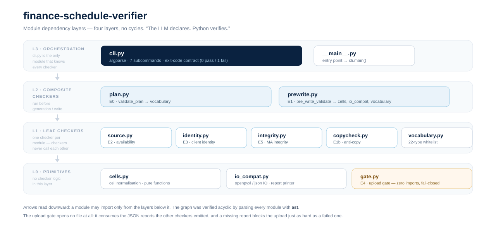
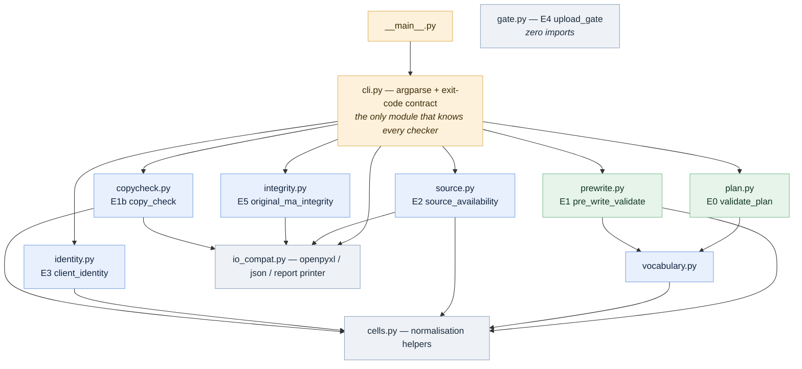
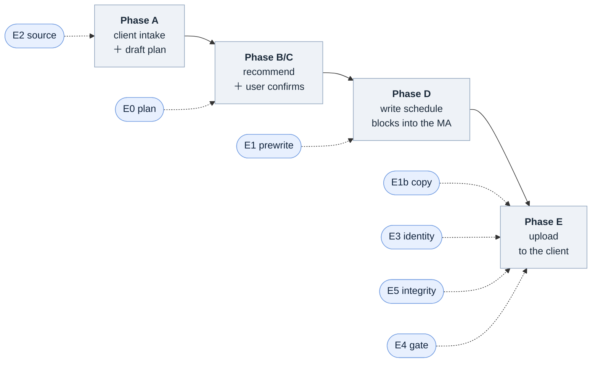

# finance-schedule-verifier

**The LLM declares. Python verifies.**

[](./LICENSE)

-lightgrey.svg)

A fail-closed verification layer that sits between an LLM-generated financial schedule
and the moment it gets uploaded to a client.

Every checker answers one narrow structural question, prints a JSON report, and exits
`0` (pass) or `1` (fail). One of them — the upload gate — reads nothing but those
reports, and refuses the upload if anything upstream is missing or red.

---

## The problem

An LLM agent can draft month-end management-account schedules (balance-sheet
breakdowns, accruals, director current accounts, …) an order of magnitude faster than
a human prepares them. The bottleneck is not generation — it is **trust**.

The usual answer is "ask the model to review its own output". That fails in a specific
and predictable way: the reviewer shares the generator's blind spots. If the model
misread which column was the amount column, the self-review happily re-reads it the
same way. Reviewing generated numbers with the same model that generated them is an
echo, not a check.

So the split in this repo is:

| | who | what |
|---|---|---|
| **Semantic judgement** | the LLM agent | *Which* sheet is the GL? *Where* is the header row? *Which* schedule types should this client have? *What* is the client's name? It **declares** all of it. |
| **Structural verification** | this package | Given those declarations, are they internally consistent? Does the workbook actually match them? Is the original file still intact? It **verifies** mechanically. |

The LLM is good at reading a messy spreadsheet and telling you what it means. Python is
good at never getting tired and never making a judgement call. Each does only its half.

---

## The verification chain

Seven checkers, run at the points where a mistake becomes expensive:

| # | Checker | Module | Question it answers | Fails when |
|---|---|---|---|---|
| **E0** | `validate_plan` | `plan.py` | Is the generation plan a legal contract? | unknown schedule type, illegal `source`, illegal `status`, duplicate type, evidence too short |
| **E2** | `source_availability` | `source.py` | Does the declared GL sheet hold usable detail? | declared sheet not found, no transaction rows, no Description/Reference columns |
| **E1** | `pre_write_validate` | `prewrite.py` | Are the output schedule blocks structurally sound? | Checking/Variance pair missing, block empty, blocks merged into one table, summary-only block, sheet name over Excel's 31-char limit |
| **E1b** | `copy_check` | `copycheck.py` | Were the items regenerated from **current** GL, or copied from last year's MA? | item overlap with the historical MA is too high |
| **E3** | `client_identity` | `identity.py` | Do the output and uploaded filenames belong to **this** client? | no significant-token overlap with the client name |
| **E5** | `original_ma_integrity` | `integrity.py` | Did the original sheets survive untouched, and in order? | original sheet deleted, reordered, or a cell changed |
| **E4** | `upload_gate` | `gate.py` | May this workbook be uploaded? | any upstream report is missing, or any of them failed |

E4 is the interesting one. It **opens no file at all** — it consumes the JSON reports
the other checkers produced and returns a verdict. Because the default is *fail*, a
missing report blocks the upload just as hard as a failed one.

---

## Quick start

```bash
git clone https://github.com/<your-account>/finance-schedule-verifier.git
cd finance-schedule-verifier

python -m venv .venv
source .venv/Scripts/activate        # Windows (Git Bash)
# source .venv/bin/activate          # macOS / Linux

pip install -r requirements.txt
python examples/demo.py
```

> The Python package is imported as **`llm_verifier`** (the repo name describes the
> domain, the package name describes the mechanism).

`examples/demo.py` runs the whole chain against the synthetic fixtures and asserts every
case. No API key, no network access. It ends with:

```
  13/13 cases behaved exactly as the fixtures were built to produce.
  All green: the chain is fail-closed end to end.
```

Each individual checker is also a normal CLI:

```bash
# E0 — is the plan a legal contract?
python -m llm_verifier validate_plan --plan fixtures/draft_plan_bad.json
# -> exit 1, violations: unknown_type, invalid_source, invalid_status,
#                       blocked_without_reason, duplicate_type, missing_evidence

# E1 — are the output blocks sound?
python -m llm_verifier pre_write_validate \
    --workbook fixtures/ma_fye2026_out_ok.xlsx \
    --schedule-sheets "Schedules - Assets" "Schedules - Liabilities" "Schedules - Dir & RP"
# -> exit 0

# E1b — did the generated items come from current GL, or from last year's file?
python -m llm_verifier copy_check \
    --workbook fixtures/ma_fye2026_out_bad.xlsx \
    --historical fixtures/ma_hist_fye2025.xlsx
# -> exit 1, possible_historical_copy: 100% of current items overlap the historical MA

# E4 — fold the reports into one verdict
python -m llm_verifier upload_gate \
    --prewrite r_prewrite.json --identity r_identity.json --integrity r_integrity.json
```

Add `--json` to any command to get the full machine-readable report (and to capture it
for the gate); without it you get a short human summary.

---

## Architecture



### Dependency layers

Four layers, no cycles. A module may only import from the layer below it, and the
direction of every arrow is "knows about". `cli.py` is deliberately the *only* place
that knows every checker exists.



### Where each checker fires



Two checkers run *before* generation (E0, E2) — cheap insurance against a plan that was
never going to work. One runs before writing (E1). The rest run before upload, where the
cost of being wrong is highest, and E4 is what actually stops the process.

---

## Design decisions

**1. The LLM declares; Python verifies.**
No checker re-guesses anything. There is no "find the sheet whose name contains
*schedule*" logic, no "assume the first sheet holds the client name", no "the header
must be row 1". The agent locates the GL sheet, names the schedule sheets it created,
and states the client name — explicitly, on the command line or in the plan JSON. The
checkers test those declarations instead of trying to infer them from cell contents.
Content probing is fragile, and worse, it silently produces a *confident* answer when
it is wrong.

**2. Checkers never call each other.**
There is no "E1 calls E3" dependency anywhere. Checkers cooperate through a shared
*report contract* and through files on disk, not through imports. That is why the
dependency graph above has no cycles, why any checker can be run alone, and why adding
an eighth checker cannot destabilise the existing seven.

**3. The gate is fail-closed and touches nothing.**
`gate.py` has zero imports — it does not even import `openpyxl`. It receives reports and
returns a verdict. A checker that was never run contributes a missing report, and a
missing report is a failure. This is the one place where being wrong is unacceptable, so
the default answer is "no".

**4. Fixtures are a generator, not a binary.**
`fixtures/build_ma_fixtures.py` builds five `.xlsx` files in pure code: the historical
MA, this year's target file, a clean output, a deliberately broken output, and an
append-only violation. Committing a generator instead of binaries keeps the sheet
layout, every number, and the *intended* violation of each bad case reviewable in a
diff. The build is byte-reproducible — `md5sum fixtures/*.xlsx` is stable across runs —
so a fixture someone opened in Excel and re-saved shows up immediately as a diff.

Getting there needed a post-processing pass: openpyxl stamps `docProps/core.xml` with
the build time unconditionally, and its zip container carries the current timestamp on
every entry. `_normalize_xlsx()` rebuilds the container in memory with pinned stamps and
a rewritten `dcterms:modified`, after which two builds are identical byte for byte.

---

## Known limitations

These are real and measured, not hypothetical. They were pre-existing in the original
monolithic script and are documented here rather than quietly patched, because each of
them says something about where the boundary of "mechanical verification" sits.

**1. The sheet-name length check only inspects the last declared sheet.**
The >31-character check in `prewrite.py` sits outside the `for title in targets:` loop,
so it validates only the final title it sees. Declaring an over-long sheet name first
makes the check report nothing; declaring it last makes it fire. A controlled experiment
confirmed both directions. The bad-case fixture fails either way (its other four
violations are per-sheet), which is exactly *why* the bug hid for so long: the aggregate
verdict stayed red for other reasons.

**2. The anti-copy threshold has more tolerance than it should.**
`copy_check` is a signature comparison, and recurring vendors legitimately produce
similar items year over year. The clean fixture already sits at 0.38 overlap against the
historical MA. Before the historical fixture carried its own Director Current Account, a
deliberately copied workbook landed at exactly **0.75 and passed** under the current 0.80
threshold. The honest demonstration pair here is 0.38 (regenerated) versus 1.00 (copied);
anything landing in the 0.6–0.8 band deserves a human look, and the threshold should
arguably move.

**3. `vocabulary.SLUG_TO_DISPLAY` is dead code.**
Left over from the monolith. Harmless, but removing it is the honest thing to do.

---

## Repo layout

```
finance-schedule-verifier/
├── llm_verifier/                  # the package — 11 modules, ~1.4k lines
│   ├── __init__.py                # checker map + usage (no side effects)
│   ├── __main__.py                # entry point -> cli.main()
│   ├── cli.py                     # argparse; 7 subcommands; exit-code contract
│   ├── cells.py                   # L0 — cell value normalisation
│   ├── io_compat.py               # L0 — workbook/JSON IO + report printer
│   ├── gate.py                    # L0 — E4 upload gate (zero imports)
│   ├── vocabulary.py              # L1 — the 22-type whitelist + synonyms
│   ├── source.py                  # L1 — E2 source availability
│   ├── identity.py                # L1 — E3 client identity
│   ├── integrity.py               # L1 — E5 original-MA append-only integrity
│   ├── copycheck.py               # L1 — E1b anti-copy guard
│   ├── plan.py                    # L2 — E0 plan contract
│   └── prewrite.py                # L2 — E1 pre-write structural validation
├── fixtures/
│   ├── build_ma_fixtures.py       # deterministic builder for all 5 workbooks
│   ├── ma_hist_fye2025.xlsx       # historical MA (FY2025) — reference only
│   ├── ma_fye2026_input.xlsx      # this year's target MA — originals only
│   ├── ma_fye2026_out_ok.xlsx     # clean output — every checker passes
│   ├── ma_fye2026_out_bad.xlsx    # 4 structural violations + copied items
│   ├── ma_fye2026_out_tampered.xlsx  # append-only violation
│   ├── draft_plan_ok.json         # well-formed plan
│   └── draft_plan_bad.json        # plan with 7 distinct contract violations
├── examples/
│   └── demo.py                    # end-to-end run, asserts 13 cases
├── requirements.txt               # openpyxl (the only runtime dependency)
└── LICENSE                        # MIT
```

The package was refactored out of a single 1,289-line script into these eleven modules,
in eleven separate commits, each verified by moving the block verbatim, confirming the
original block was fully removed, running `pyflakes`, and re-running the full checker
regression.

---

## Data and privacy

**Everything in `fixtures/` is synthetic.** The client is a fictional "DEMO PTE LTD"
(`DEMO-PTE-LTD`), the FYE and every amount are invented, and the builder script contains
no real client name, vendor or figure. There is no production data in this repository,
and the package has no network access path — the only dependency is `openpyxl`.

> ⚠️ `fixtures/ma_fye2026_out_bad.xlsx` intentionally contains a worksheet name longer
> than Excel's 31-character limit. That is the input the E1 name check exists to reject,
> before the save is attempted. **Do not open that file in Excel** — it will offer to
> repair and rename the sheet.

---

## License

MIT — see [LICENSE](./LICENSE).
